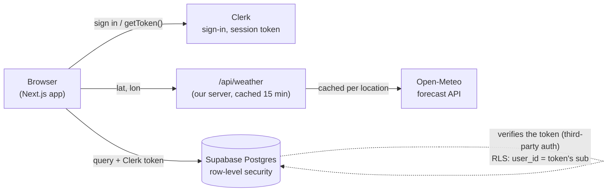

# Bucket List ⛳: Full Stack

*Log a round hole by hole at a real Chicago course, see what cost you strokes, and get a practice plan that knows the weather.*

Design, Build, Ship (MPCS 51238), Assignment 4. This extends my Assignment 3 tool from a one-device prototype (`localStorage`) into a multi-user app: classmates create an account, their rounds and practice are saved to a database, and each person sees only their own.

- **Live:** [design-build-ship-assignment4-ten.vercel.app](https://design-build-ship-assignment4-ten.vercel.app/)
- **Stack:** Next.js 16 + Tailwind CSS · Clerk (sign-in, development keys) · Supabase (Postgres + row-level security) · Open-Meteo (weather API) · Playwright · Vercel Hobby
- **Progress log:** [`PROGRESS.md`](PROGRESS.md) · **Agent context:** [`AGENTS.md`](AGENTS.md) · **Flows (from A3):** [`flows.md`](flows.md)

## What it does

- **Try it without an account.** Signed-out visitors can play a round or plan a session as a guest. It's kept only in that browser tab, with a banner (which you can close) inviting you to create a free account to keep it. Sign up or sign in and the trial is added to your account.
- **Play a round** at one of six real Chicago public courses (Jackson Park, Harborside Port and Starboard, Sydney R. Marovitz, Columbus Park, Robert A. Black) with the **official scorecards**: par, handicap and yards per tee for every hole. Or add your own course.
- **Find a course** with a forgiving search: typos ("jakson"), any word order ("port harb"), and nicknames or neighborhoods ("Waveland", "Hyde Park").
- **Weather at the course:** conditions now and for the next four hours, with icons, plus playing advice ("Wind 15 mph, gusting 25: club up into it…"). A copy of the weather is saved with each round and shown on its summary.
- **Round summary:** the one area that cost you the most strokes ("Where to focus: Putting"), with the reason, and you lock it in as your practice focus.
- **Practice plan** for 15, 30 or 60 minutes, with a short **how-to video** for each drill, and **where to practice today**: outdoor range, heated bay, or indoor simulator, picked from Chicago's weather, with real places to go.
- **History and a bucket list** of badges and challenge medals that tick themselves off as you play.

## How it works



**Tracing a save** (e.g. finishing a hole):
1. In the **browser**, the screen updates at once (`update()` in `src/lib/storage.ts`).
2. The changed row is then saved in the background through `supabase-js`. `getToken()` asks **Clerk** for the signed-in user's session token, and it goes with the request.
3. **Supabase** checks the token's signature (third-party auth with Clerk) and runs the row-level security policy: the row's `user_id` must equal the token's `sub`. The database fills in `user_id` itself, so the app never sends it.
4. If the save fails, it stays queued and is retried, with a banner saying so.

**Where the app knows who you are, and where it decides what you see:** Clerk knows who you are (the session token, read by `src/proxy.ts` and `useAuth()`). **Supabase RLS decides what you see.** The app never filters by user itself, and there's no secret or service-role key anywhere, so every query runs as you.

**Where the API is called, and why:** Open-Meteo is called **on the server**, in `src/app/api/weather/route.ts` → `src/lib/weather-server.ts`, never from the browser. It needs no key, so the reasons are:
- **Caching and rate limits:** a `"use cache"` helper keeps each location for 15 minutes, so everyone looking at the same course shares one call. The free tier allows about 10,000 a day. The first call took about 0.74 s; cached ones about 0.03 s.
- **One place to handle failure:** a bad location answers 400, and an unavailable forecast answers 502. The screens design for each: a loading skeleton; "no forecast" (a custom course without a location, or no data for this hour); and "unavailable", with *Try again* and "you can still play". Add `?weather=down` to a course page to see that last one.

## Data

Four tables, each with `user_id text default (auth.jwt() ->> 'sub')` and **row-level security on every table**: four policies (select, insert, update, delete) built on one rule, `(select auth.jwt() ->> 'sub') = user_id`. The `anon` role has no access.

| Table | Holds |
|---|---|
| `rounds` | One per round: course, tee, holes (JSON), and a **weather snapshot** at tee time |
| `practice_sessions` | One per session: focus, minutes, feel, drills, challenge score, weather |
| `custom_courses` | Courses you add yourself |
| `user_settings` | One row per person: current focus, weekly goal, hole notes, badges |

The built-in courses, practice facilities and drill videos are shared, read-only reference data, so they ship in the code (`src/data/`) instead of the database. Schema changes are migrations in [`supabase/migrations/`](supabase/migrations/).

## Keys

- Keys live in `.env.local` (git-ignored) and in Vercel's environment variables, never in the code or the repo. `.claude/settings.json` has a **deny rule** so the agent can't read `.env` files.
- The browser only ever gets **publishable** values (`NEXT_PUBLIC_CLERK_PUBLISHABLE_KEY`, `NEXT_PUBLIC_SUPABASE_URL`, `NEXT_PUBLIC_SUPABASE_PUBLISHABLE_KEY`). `CLERK_SECRET_KEY` stays on the server. There is no Supabase secret key at all.
- I checked the deployed site: 7 pages, their headers and all 18 JavaScript bundles contain **no secret key**. The only keys in them are the publishable ones, which is by design.

## Testing

Seven Playwright tests (`npm run test:e2e`) in [`tests/e2e/`](tests/e2e/). The two test accounts are Clerk `+clerk_test` users that sign in with one-time tickets, so no passwords are stored anywhere.

| Test | Checks |
|---|---|
| `two-users.spec.ts` | **Two golfers each save a course; neither can see the other's** |
| `guest-trial.spec.ts` | A guest's trial is saved to the account on sign-in; the banner can be closed |
| `weather.spec.ts` | Weather is saved with a round, and a round still starts when weather is down |
| `summary-advice.spec.ts` | Skipped tee-shot taps aren't counted as missed fairways |
| `course-search.spec.ts` | Typos, word order and nicknames find the right course |
| `drill-video.spec.ts` | Nothing loads from YouTube until you tap "Watch how" |

**Watched it fail first.** I broke the `custom_courses` select policy on purpose (`using (true)`), and the two-user test failed: `Expected: 0, Received: 1`, because Golfer A's course list showed Golfer B's course. Restoring the real rule made it pass. Both migrations are in the history, and the write-up, with the failing output, is in [`docs/step7/`](docs/step7/README.md).

## Review

- **`/security-review`** on the feature branch (51 files): no high- or medium-severity findings. One low-impact note: a guest trial left open in a shared browser tab would be added to whoever signs in next in that same tab.
- **A UI/UX review** of the running app at desktop and phone sizes found, among other things:
  - Skipped tee-shot taps counted as missed fairways, so a perfect round was told to practise **driving**.
  - Old "saved on this device" wording.
  - Focus jumping to "End round" (and scrolling the hole screen down) on a phone.
  - The summary's main decision sitting in the narrow column.

  All four are fixed, each with a commit.

## Design changes from Assignment 3 feedback

- **"Where do I look?"** Two-column pages went from an almost-even 5/7 split to **4/8**, with the wide column for the task. The header now has one solid button (Sign up); the current tab is an underline.
- **Too many fonts and styles:** two typefaces, **four text roles**, and regular or semibold only. Sixteen one-off sizes were removed.
- **Long forms:** the practice log asks **three things**. The rest sits under "Add details (optional)".
- **The "See your bucket list" bounce:** a toast tidied the URL with a navigation that raced the click. Now it doesn't navigate.
- **"What does it look like with no data?"** A landing page, a guest trial, and empty states that say what to do first.

## Agentic workflow

**What I stopped or redirected:**
- I didn't let the agent commit the agent-skill files it installed.
- I rejected sign-in being required, and asked for a guest trial instead.
- I had it remove the A3 Reset menu and a wind compass that was too small to be useful.
- I asked for a closable banner with a softer animation, "Heated" instead of "Covered, heated", and shorter facility cards.

**What I caught along the way:**
- The Clerk CLI wrote `.env.local` itself (the brief says to write it by hand). The agent filtered the CLI's output so it never saw a key.
- I pointed the Supabase MCP server at the wrong ID twice (a name, then the Clerk app ID) before using the real project ref.
- A round I deleted looked like a bug until we read Supabase's logs.
- I corrected a course scorecard against the official card.
- While restoring RLS after the fail-first test, the MCP session expired. The agent retried and checked the live policies, but RLS stayed open for about 3½ minutes instead of 1.
- The first Playwright run caught a real bug: a form could save before the account had loaded.

## Run it locally

```bash
npm install
# .env.local (create it yourself):
#   NEXT_PUBLIC_CLERK_PUBLISHABLE_KEY=pk_test_...
#   CLERK_SECRET_KEY=sk_test_...
#   NEXT_PUBLIC_SUPABASE_URL=https://<project-ref>.supabase.co
#   NEXT_PUBLIC_SUPABASE_PUBLISHABLE_KEY=sb_publishable_...
npm run dev          # http://localhost:3000
npm run test:e2e     # Playwright (uses the dev server)
```

## Free tiers

Everything runs on free plans: Vercel Hobby, Supabase Free, Clerk development instance, Open-Meteo, and no payment methods. Supabase pauses a free project after a week without use, so open the app now and then until grades are back.
