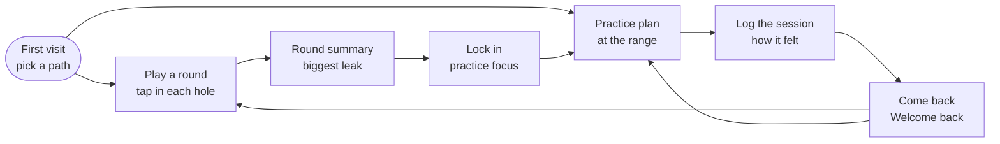
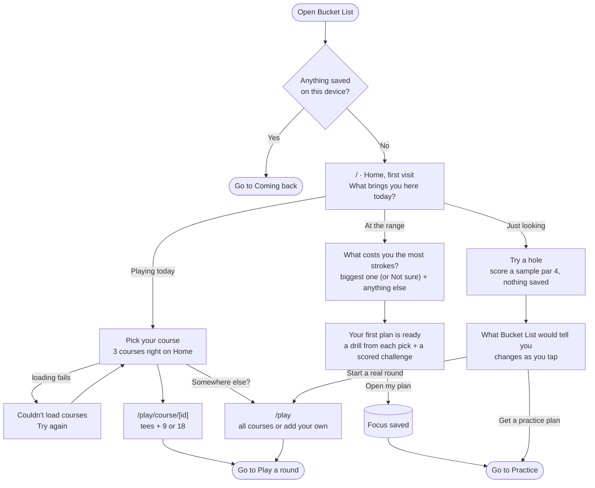
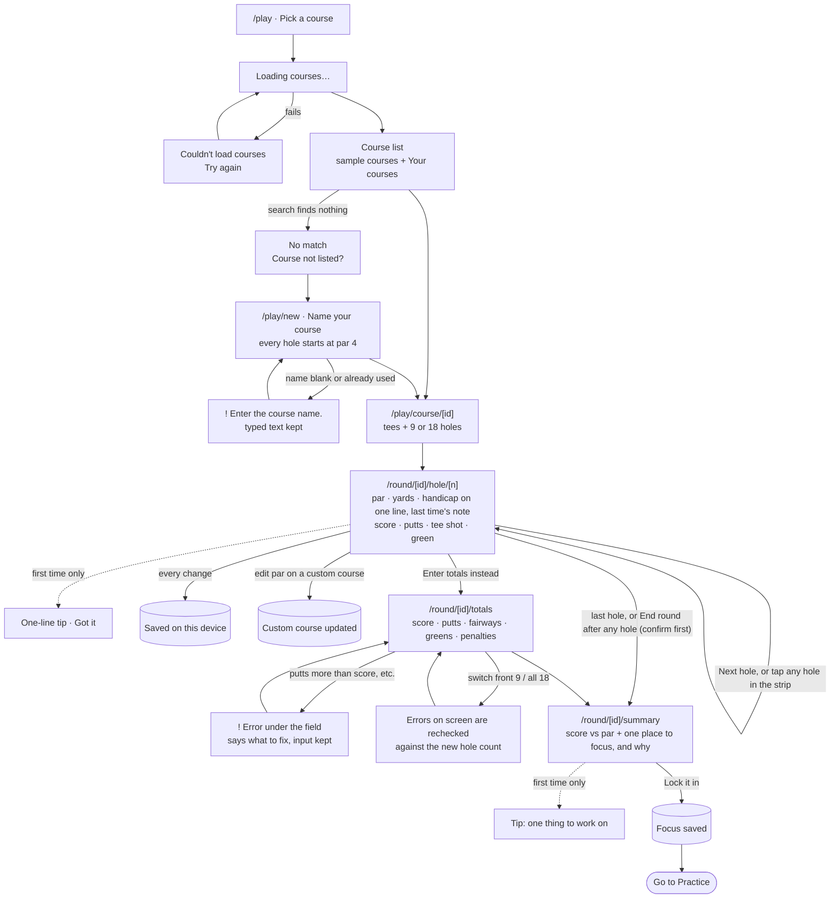
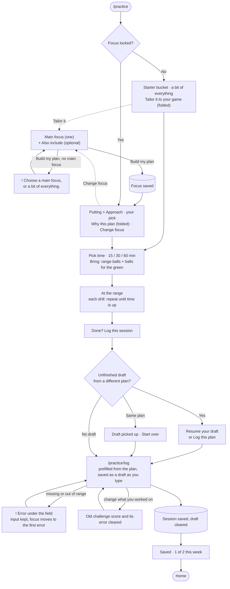
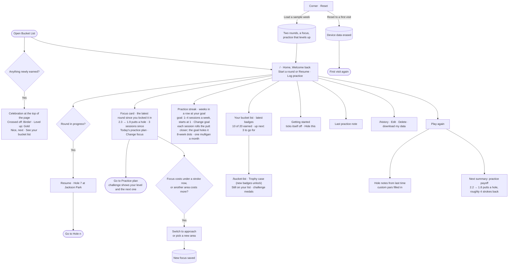

# Bucket List: user flows

**Core flow, in one sentence:**

> I tap in each hole as I play → the summary shows what cost me the most strokes → next time I'm at the range it gives me a plan for that → I log how practice went, and it's all waiting when I come back.

Each box with a route (`/play`, `/practice/log`, …) is its own page in the app. Rounded boxes link to another diagram. Cylinders are writes to `localStorage`. Dotted lines are one-time or optional extras.

## Overview: the loop

## 1 · First visit (nothing saved): the onboarding

No tour and no setup wall: one question, then the thing you came to do, right on the home page.

## 2 · Core task: play a round → get a focus

## 3 · Practice: plan → log

## 4 · Coming back (something saved)

## Steps, states, and errors added while planning with the agent

I asked the agent what steps, states and errors it would add, then chose which to keep:

| Added | Why |
|---|---|
| Course loading and load-error states | The course "database" is faked as an async call, so there's a real loading/retry moment |
| Search empty state → "Course not listed" | No dead ends when your course isn't in the list |
| Custom courses | Pars you set for an unlisted course are saved and reused next time |
| Autosave every hole + Resume card | Phones die mid-round, and the round can't be lost |
| Finish early (first after 6+ holes, now after any hole) | From Arccos: you still get a useful summary from a partial round |
| Green prefilled from score − putts; fairway hidden on par 3s | From 18Birdies: fewer taps per hole |
| Totals fallback with cross-field errors | For when you forgot to track hole by hole |
| Weekly goal instead of a daily streak | A forgiving reason to return, not guilt |
| Hole notes from last time on the hole screen | Course memory: the reason to open it on the course again |
| JSON export on History | localStorage can be cleared, so give people a way out |

### Added after the first build, from my feedback

| Added | Why |
|---|---|
| Three-path first visit (playing / at the range / just looking) | "How it works" text wasn't real onboarding. Each path does something useful right away instead |
| At the range: pick every area that costs you strokes | One leak is rarely the whole story. The first pick leads, drills mix in from the rest, and "Not sure" stays exclusive |
| Just looking: try a sample hole | From 18Birdies' "preview from the couch": see the advice before committing to a round. Nothing is saved |
| Getting-started checklist | Guides the first week (play → focus → practice) and checks itself off from what you actually did |
| One-time tips on the hole, summary and practice screens | Explain each screen once, in place, instead of a tour up front |
| Practice with no focus asks you to pick one | "Why this plan" made no sense when nothing had been chosen |
| Errors recheck when a field they depend on changes | Switching focus or 9/18 holes left messages quoting the old limits |
| Reset menu in the top bar (reset / sample week) | Lets me test the first visit and the return visit without clearing the browser by hand |
| Compact hole screen | Simplicity: course facts on one line and fewer hints, so Next fits on a phone screen |
| Main focus + Also include | Changing the lead area by pick order was confusing; one main choice is easy to revise |
| Practice drafts with Resume / Log this plan | Leaving the log form never loses work, and it never silently mixes an old draft with a new plan |
| Drills say how to fill their time; minutes add up | "Repeat the ladder until time is up" instead of a fixed count that didn't match the minutes |
| "Bring:" instead of a ball count | Range balls get used up; putting and chipping reuse a few balls |
| Edit and Delete in History | Fixing a mistyped score or note matters more than another dashboard card |
| End round after any hole | Rounds get cut short (weather, daylight, a call). One confirm step stops stray taps, and summaries under 6 holes say they're a first hint |
| A golf bucket list (20 achievements) | Leans into the name: goals that tick themselves off from what you log, with "up next" so there's always a target |
| Weekly streak with a monthly mulligan | Weeks, not days, and one forgiven week a month, so the streak motivates instead of guilting |
| Bronze / Silver / Gold challenge levels | From Break X: every session has a next level to beat |
| Practice → round payoff | Shows whether practice showed up in the next round, which closes the loop the app is built on |
| Celebrations at the top of the page | New achievements and level-ups get a moment, without covering inputs; announced to screen readers |
| Badges and a trophy case | A checklist didn't read as accomplishments: each goal is now a medallion badge that unlocks with a pop, shine and sparkles, and earned ones live in a Trophy case (latest ones on Home) |
| Focus card follows the latest round | First-run feedback: the card quoted the round that set the focus, rounds later. It now shows progress since you locked it in, and offers to switch when the focus stops costing strokes |
| Weekly goal you choose, starting at 1 | First-run feedback: a fixed goal of 2 kept the streak at 0 for someone practising weekly |
